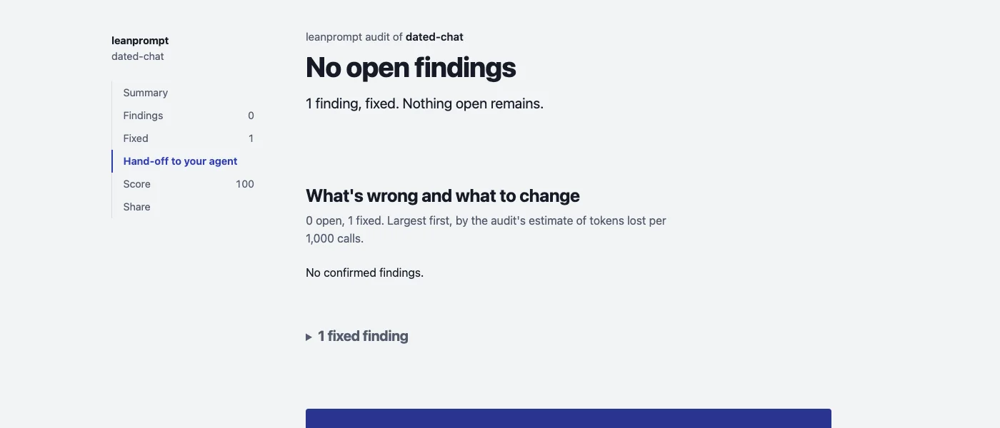

# leanprompt

**Get more from every LLM call your app makes.**

Effective, efficient and affordable: your coding assistant makes prompts cacheable, cuts dead weight, stops wasted output and speeds up first tokens, without changing the answers. leanprompt is a set of skills for coding agents, by the LM Warden Team. It is not a prompt-compression library, and it works on the app the assistant is building, not on the assistant's own bill.

[](LICENSE)
[](https://github.com/Podwarden/leanprompt/actions/workflows/ci.yml)
[](docs/install.md)
<!-- pending: this repo's own leanprompt badge, once .leanprompt/score.json is committed from a measured run -->

From your project root:

```
npx leanprompt install
```

The npm package is being published and that line does not work yet. Until it does, run `npx github:Podwarden/leanprompt install` (Node 20.19 or newer). It finds the assistants you use, asks whether to install for this project or for all your projects, shows every file it will write, and asks before writing.

Reload your assistant, then type `/leanprompt init` (`$leanprompt init` in Codex).

Works with Claude Code, Codex, Cursor, OpenCode and any agent that reads `AGENTS.md`. In Claude Code you can install the plugin instead, inside a session: `/plugin marketplace add Podwarden/leanprompt`, then `/plugin install leanprompt@leanprompt`; then the command is `/leanprompt:leanprompt`, or `/leanprompt` when no other command has that name ([docs/install.md](docs/install.md)).

| Without leanprompt | With leanprompt |
|---|---|
|  |  |

The same example app, [`examples/dated-chat`](examples/dated-chat/README.md), audited before and after one fix. Before, the system prompt starts with the time to the second, so no call can reuse the handbook that follows it. After, the time moves to the newest message and the prompt head stays the same on every call. Both pages show estimates from the code, not measurements; `/leanprompt measure` turns a fix into a before and after number.

## Commands

Type `/leanprompt` alone to see them in your assistant. `npx leanprompt --help` lists the terminal commands.

| | Commands |
|---|---|
| **Set up** | `npx leanprompt install` installs the skills · `npx leanprompt update` refreshes them · `/leanprompt init` writes `leanprompt.yaml`: your targets, priority, volume and prices |
| **Audit** | `/leanprompt audit` finds every LLM call and ranks where it loses tokens and time · `/leanprompt score` scores the app, measured or static |
| **Fix and prove** | `/leanprompt fix` checks each finding, shows a diff, applies it on your yes · `/leanprompt measure` proves it with a before and after |
| **Share** | `/leanprompt report` writes a local page in plain English · `/leanprompt lesson` drafts a lesson-learned issue, sending nothing · `npx leanprompt score --github` annotates a pull request ([docs/ci.md](docs/ci.md)) |

Until the npm release, run each `npx leanprompt <cmd>` as `npx github:Podwarden/leanprompt <cmd>`. The usage logger that `measure` adds to your app installs from GitHub too: `npm i github:Podwarden/leanprompt#v0.1.0-dev.1`, or for Python `pip install "git+https://github.com/Podwarden/leanprompt#subdirectory=python"`; your assistant asks first.

No telemetry, no proxy, no hosted service, no account. It does not edit your code without asking.

## Why

Every call to an LLM resends the system prompt, the tool list and the history. Providers cache the part that did not change, but only if it really did not change, byte for byte, from the first token. Most apps break that without knowing: a timestamp on the first line, tools built from an unsorted dict, a client that never sends Anthropic's cache marks. Then they pay again for output: a retry after a truncation, one request per sample, a parse failure re-asked from scratch.

| What changed | Before | After |
|---|---|---|
| Replayed coding-agent sessions on Anthropic: did the client send cache marks? No marks: Codex and OpenCode sessions; 3 marks: a Claude Code session | no marks: 0 tokens from cache on 29 turns (E1) | 3 marks: 92% of prompt tokens from cache on one session (435,661 of 471,607) (E1) |
| Thinking toggled between turns vs kept the same, one session on a self-hosted vLLM (Qwen hybrid model) | toggled turns lost 47% of what they could have reused (E7) | turns with the same setting as the turn before lost nothing beyond the engine rule (E7) |
| Cache-aware replica routing (LM Warden, an engine setting, not a prompt rule); synthetic load, 8 concurrent agent sessions, one run per arm; at 24+ sessions (overload) the median got worse | median time to first byte 2.33 s; 44% of prompt tokens from cache (E10) | median time to first byte 0.48 s; 86% from cache; output tokens a minute +29% (E10) |

<!-- pending: eval/results (example apps before/after, measured; one row per app once real runs are committed) -->

And one that went the other way: moving the date to the end of the prompt cut correct date answers from 10/12 to 1/12 and did not help the cache (E6). leanprompt's rules keep meaning first. Every figure above is a row in [docs/evidence.md](docs/evidence.md), with its source and its limits.

## What's in the box

Seven skills, each a folder with a `SKILL.md`; the rule skills have one file per rule.

- [`leanprompt`](skills/leanprompt/SKILL.md): the entry point; routes each command to the skill below that does the work.
- [`llm-call-audit`](skills/llm-call-audit/SKILL.md): finds every LLM call, checks it against the rules, ranks the findings and writes the report.
- [`prefill-cache`](skills/prefill-cache/SKILL.md): prompts the provider's prefix cache can reuse (LP-PC-01 to LP-PC-12).
- [`generation-economy`](skills/generation-economy/SKILL.md): samples, budgets, timeouts, retries and batching that do not waste calls or output (LP-GE-01 to LP-GE-10).
- [`prompt-diet`](skills/prompt-diet/SKILL.md): dead weight in what each call sends, every trim with an answer check (LP-PD-01 to LP-PD-06).
- [`measure-loop`](skills/measure-loop/SKILL.md): measure, change one thing, measure again; the usage logger, the stable-head CI test, the score.
- [`lmwarden`](skills/lmwarden/SKILL.md): self-hosted engines (vLLM, SGLang, LM Warden): engine settings, replica routing, cache isolation (LP-LW-01 to LP-LW-03).

## Learn more

- [Install and update](docs/install.md): every assistant, project or global, the Claude Code plugin, Windows.
- [How it works](docs/how-it-works.md): the audit, the rules at a glance, and how to prove a fix.
- [The score and the badge](docs/score.md), [calibration](docs/calibration.md) and [leanprompt in CI](docs/ci.md).
- [Provider notes](docs/providers.md) and [self-hosting](docs/self-hosting.md), including LM Warden and its limits.
- [All docs](docs/README.md), including the [evidence table](docs/evidence.md) and the [changelog](docs/CHANGELOG.md).

## Contributing

Issues and pull requests are welcome. A new rule needs a "Verify" section and either a measured example or a dated provider-doc source; commits carry a DCO sign-off. See [CONTRIBUTING.md](.github/CONTRIBUTING.md), [GOVERNANCE.md](.github/GOVERNANCE.md) and [SECURITY.md](.github/SECURITY.md). If leanprompt helped you, or a rule misled you, share a lesson in general terms with the [Lesson learned form](https://github.com/Podwarden/leanprompt/issues/new?template=lesson-learned.yml); credit is optional ([THANKYOU.md](docs/THANKYOU.md)).

## License

Code (`cli/`, `eval/`, `examples/`, `python/`, `scripts/`) is under [Apache-2.0](LICENSE). The skills, provider and model tables, docs and this README are under [CC BY 4.0](LICENSE-DOCS). Copyright the LM Warden Team. "PodWarden" and "LM Warden" are trademarks of their owners; see [NOTICE](NOTICE).

## Related projects

- [kvsig](https://github.com/Podwarden/kvsig): the open spec for keyed conversation and prefix ids that the stable-head test and the measured score use.
- [LM Warden](https://github.com/Podwarden/lm-warden): self-hosted, cache-aware model serving on your own NVIDIA GPUs.
